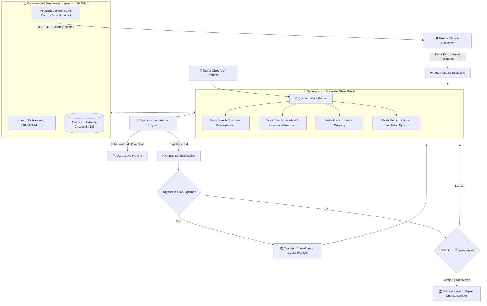

# 🌌 Quantum Agent

> **Autonomous Quantum-Inspired Multi-Model Agent Framework with Model Context Protocol (MCP) & Infinite Possibility Search**

[](LICENSE)
[](pyproject.toml)
[](https://modelcontextprotocol.io)
[](requirements.txt)

---

## ⚡ What is Quantum Agent?

Traditional AI agents reason in a single, linear thread (step $A \to step\ B \to step\ C$). When they hit an error, rate limit, or complex multi-variable problem, they fail or produce shallow hallucinations.

**Quantum Agent** is built on the core computational principles of quantum computing:
1. **Superposition & Multi-Branch Exploration**: Evaluates $N$ orthogonal hypotheses and possibilities simultaneously rather than sequential trial-and-error.
2. **Constructive & Destructive Interference**: Amplifies high-confidence reasoning paths (Grover's Amplitude Amplification) while pruning dead ends.
3. **Quantum Tunneling**: Detects when reasoning is trapped in local optima or defensive walls, executing high-entropy lateral leaps to bypass barriers.
4. **Infinite Possibility Queue (Zero Limits)**: Built on a high-throughput SQLite WAL state engine capable of evaluating millions of possibilities without memory exhaustion.
5. **Multi-Day/Week Autonomous Persistence**: Run continuous sessions for seconds, hours, days, weeks, or months with live HUD telemetry (`DD:HH:MM:SS`).
6. **Smart AI Rate-Limit Sentinel**: When an AI API hits HTTP 429 or quota limits, the agent freezes active states, calculates backoff cooldown, displays a live resume countdown, and **automatically resumes without losing progress**.
7. **Universal AI Connector**: Connect to **Google Gemini, OpenAI, Anthropic Claude, DeepSeek, Groq, OpenRouter, or local Ollama/LMStudio models**.
8. **Native Model Context Protocol (MCP)**: Exposes quantum reasoning directly to Claude Desktop, Cursor, Antigravity, and Cline.

---

## 📐 System Architecture



---

## 🚀 Quick Start

### 1. Installation

Quantum Agent core requires **zero third-party dependencies**! It runs straight out of the box on Python 3.9+:

```bash
git clone https://github.com/your-username/quantum-agent.git
cd quantum-agent
```

Optional editable install:
```bash
pip install -e .
```

### 2. Configure AI Providers (Any AI)

Set the API key for your preferred provider:

```bash
# Google Gemini
export GEMINI_API_KEY="your-gemini-key"

# OpenAI
export OPENAI_API_KEY="your-openai-key"

# Anthropic Claude
export ANTHROPIC_API_KEY="your-anthropic-key"

# DeepSeek
export DEEPSEEK_API_KEY="your-deepseek-key"

# Groq
export GROQ_API_KEY="your-groq-key"

# Local Ollama (No API Key Required!)
# Simply have Ollama running at http://localhost:11434
```

Check detected providers anytime:
```bash
python3 -m quantum_agent.cli providers
```

---

## 💻 CLI Usage

### Basic Run
```bash
python3 -m quantum_agent.cli run \
  --target "Build a thread-safe lock-free queue in Python with zero memory leak" \
  --intensity FAST
```

### Unbounded High-Intensity Run (Infinite Possibilities)
```bash
python3 -m quantum_agent.cli run \
  --target "Synthesize a robust consensus algorithm resilient to 33% Byzantine failures" \
  --intensity HIGH \
  --provider gemini \
  --model gemini-2.5-flash
```

### Resume a Past Session
```bash
python3 -m quantum_agent.cli run \
  --target "Resuming research problem" \
  --session qsession-edaae5eb
```

### Inspect Sessions & Telemetry
```bash
# List all active and completed sessions
python3 -m quantum_agent.cli status

# Deep-dive into a specific session
python3 -m quantum_agent.cli status --session qsession-edaae5eb
```

---

## 🔌 Model Context Protocol (MCP) Integration

Quantum Agent is a fully compliant MCP Server over `stdio`. It exposes tools directly to Claude Desktop, Cursor, Antigravity, and Cline.

### Available MCP Tools:
- `quantum_solve`: Solve high-complexity problems with superposition search and exact verification.
- `quantum_explore_branches`: Decompose a problem into orthogonal quantum basis vectors.
- `quantum_tunnel`: Force a lateral quantum leap to bypass an intractable defensive wall or bottleneck.
- `quantum_session_status`: Retrieve live uptime and state metrics for long-running jobs.

### Configuration for Claude Desktop / Cursor / Antigravity

Add this to your MCP configuration file (`claude_desktop_config.json` or `mcp_settings.json`):

```json
{
  "mcpServers": {
    "quantum-agent": {
      "command": "python3",
      "args": ["-m", "quantum_agent.cli", "mcp"],
      "cwd": "/path/to/quantum-agent",
      "env": {
        "GEMINI_API_KEY": "your-key-here"
      }
    }
  }
}
```

---

## 📂 Project Structure

```
quantum-agent/
├── README.md                  # Comprehensive Documentation & Guide
├── LICENSE                    # MIT License
├── pyproject.toml             # Modern packaging standard
├── requirements.txt           # Zero required runtime dependencies
├── quantum_agent/
│   ├── cli.py                 # Rich CLI with live HUD & subcommands
│   ├── core/
│   │   ├── superposition.py   # Multi-branch basis expansion
│   │   ├── interference.py    # Amplitude amplification & pruning
│   │   ├── tunneling.py       # Local optima escape & lateral leaps
│   │   └── convergence.py     # 100% exact solution verifier
│   ├── engine/
│   │   ├── persistence.py     # SQLite WAL crash-resilient storage
│   │   ├── telemetry.py       # Live timer HUD (DD:HH:MM:SS)
│   │   └── scheduler.py       # Autonomous long-run orchestrator
│   ├── providers/
│   │   ├── base.py            # LLM interface & response dataclass
│   │   ├── universal.py       # Universal AI adapter (Gemini, Claude, GPT, Ollama)
│   │   └── rate_limiter.py    # Rate-limit backoff & auto-resume
│   └── mcp/
│       ├── server.py          # Standard JSON-RPC 2.0 MCP server
│       └── tools.py           # Quantum Agent MCP tools
├── examples/
│   ├── solve_coding_problem.py
│   └── mcp_client_example.py
└── tests/
    ├── test_superposition.py
    ├── test_persistence.py
    └── test_mcp_server.py
```

---

## 🛡️ License

This project is licensed under the **MIT License**. See [LICENSE](LICENSE) for details.
